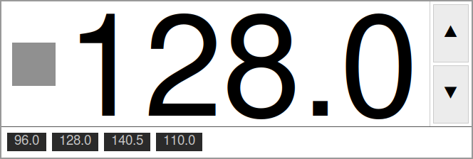

big-tempo
=========

A large JACK tempo display for controlling and following tempo during live
performance. The BPM readout scales to fill its window at whatever size you
set, so it can be read from across a stage or a room. The tempo can be
changed with the on-screen buttons, the mouse, or MIDI control changes (via
**mididings**), and each change can be sent on to other software -- a drum
machine such as Hydrogen, for example -- as MIDI or OSC (via
**python-osc**). It also follows tempo changes from a JACK transport master,
and can send MIDI or OSC when the transport starts or stops.

   The default view: an auto-scaling BPM readout, the JACK transport
   indicator on the left, and the increment/decrement buttons on the right.

         values as pills below the readout

   With the tempo list panel open: BPM values saved during soundcheck show
   up as pills that can be stepped through live.

Features
--------

- Large BPM readout that auto-scales to the window size
- JACK transport rolling indicator (grey → red)
- **▲ / ▼ buttons** with configurable hold-to-repeat
- **mididings MIDI I/O** (JACK MIDI backend)

  - Receive CCs to raise, lower, or set the BPM, or to work the tempo list

- **python-osc OSC output** for absolute tempo commands (recommended for
  Hydrogen, which only supports relative BPM over MIDI)
- **Outgoing MIDI/OSC triggers** – fires a configurable list of MIDI and/or
  OSC actions on five events: every tempo change you make, a tempo followed
  from JACK being quantized, and JACK transport start / stop / either
  transition; each trigger can send to several destinations at once (for
  example, the same tempo to Hydrogen and to a second program)
- **Tempo list** – save BPM snapshots during soundcheck and cycle forward or
  backward through them live (``list_next`` / ``list_prev``); also fully
  controllable from the mouse and keyboard (double-click to append, Tab /
  Shift+Tab to step, click a pill to jump, middle-click to remove, scroll
  wheel to nudge BPM)
- Per-receive send lists – any incoming CC can fire extra MIDI and OSC
  messages independently of its BPM action
- Follows tempo changes broadcast by an external JACK transport master
  (e.g. Hydrogen), except for 1.5 s after you change the tempo yourself, so
  your change is not immediately overridden; following fires no outgoing
  MIDI or OSC on its own, but if ``quantize_jack`` snaps the value, the
  separate ``on_quantize`` trigger fires
- Optional BPM quantization, snapping tempos to a grid such as whole or
  half BPM

Requirements
------------

.. list-table::
   :header-rows: 1
   :widths: 20 50

   * - Requirement
     - Notes
   * - Python ≥ 3.9
     -
   * - tkinter
     - Usually bundled with Python; ``python3-tk`` on Debian/Ubuntu
   * - ``JACK-Client``
     - From PyPI, via the ``jack`` or ``full`` extra (see Installation)
   * - ``mididings``
     - The maintained version from PyPI, via the ``midi`` or ``full``
       extra; compiled on install (see Installation)
   * - ``python-osc``
     - Included in ``pip install -e .`` (pure Python, no C extensions)

Both ``JACK-Client`` (the ``jack`` module) and ``mididings`` are **optional**
at runtime.  Without ``JACK-Client``, the JACK transport indicator and
tempo following are silently disabled (no warning).  Without ``mididings``, MIDI I/O prints
one warning line and stays off.  If ``mididings`` is installed but no JACK
server is reachable, the background MIDI thread prints a connection-error
traceback to stderr on startup instead of a clean warning – this does not
crash the app.
``python-osc`` is a hard dependency and is installed automatically.

**Platform.**  Developed and tested on Ubuntu 24.04; other Linux
distributions should work the same way.  A running JACK server is needed
for the transport indicator, tempo following and MIDI.  MIDI input and
output use JACK MIDI ports; a controller that appears only as an ALSA
MIDI device can be bridged into JACK with ``a2jmidid``.  The
community-maintained ``mididings`` fork this project depends on
(https://github.com/mididings/mididings) also lists macOS as supported,
although that has not currently been tested here; mididings does not
support Windows.

Installation
------------

The package is not on PyPI.  Clone the repository first::

    git clone https://github.com/abarker/big-tempo.git
    cd big-tempo

Installing into a virtual environment is recommended.  Create one inside
the clone, or wherever you prefer, then activate it::

    python3 -m venv .venv
    source .venv/bin/activate

``mididings`` is compiled when pip installs it, so first install the
system libraries it builds against, and tkinter::

    # Debian / Ubuntu
    sudo apt install build-essential pkg-config python3-dev python3-tk \
        libasound2-dev libjack-jackd2-dev \
        libboost-python-dev libboost-thread-dev libglib2.0-dev

The ``mididings`` that pip installs is the maintained community version
from PyPI.  Don't use a distribution package instead: Ubuntu 24.04 has
none, and older ones, where they exist, are the original, unmaintained
release.

Then install the package with its optional extras, which pull in
``JACK-Client`` and ``mididings`` from PyPI (``python-osc`` comes in
automatically)::

    pip install -e ".[full]"           # same as pip install -e ".[jack,midi]"

Without the extras (``pip install -e .``), the JACK transport indicator,
tempo following and MIDI I/O are left out, as described above.

For development (adds pytest)::

    pip install -e ".[full,dev]"

.. note::

   If the ``mididings`` build fails, check that the system libraries above
   are installed, then re-run the ``pip install`` command.

Running
-------

.. code-block:: bash

    big-tempo                          # uses ~/.config/big-tempo/config.py
    big-tempo --config my_config.py
    big-tempo --no-titlebar --always-on-top
    python -m big_tempo                # also works

If you installed inside a venv, pip (with or without ``-e``) writes that
venv's own interpreter into the installed ``big-tempo`` command as an
absolute shebang, so it runs without the venv activated afterward -- the
shell only needs a way to find it, e.g. its full path
(``/path/to/venv/bin/big-tempo``) or that venv's ``bin/`` on ``PATH``.
``pipx install`` works the same way and puts the command on ``PATH`` for
you.

Connect a MIDI controller to big-tempo's JACK MIDI ports with ``jack_connect``
or a patchbay such as QjackCtl.  The client is named ``big_tempo_midi`` by
default (``midi.client_name`` in the config), with input port ``in`` and
output port ``out``::

    jack_connect "your-controller:MIDI Out" "big_tempo_midi:in"
    jack_connect "big_tempo_midi:out" "your-target:MIDI In"

In ``--no-titlebar`` mode, right-click anywhere on the window for a menu
with **Quit** and **Cancel**, since that mode has no title-bar close button.

All CLI options::

    --config PATH         Python dict literal config file
    --width-in FLOAT      Window width in inches
    --height-in FLOAT     Window height in inches
    --update-ms INT       How often to poll JACK and refresh the display, in
                          milliseconds (default 100).  Incoming MIDI is
                          handled on the same tick, so this is also the most
                          a MIDI command can wait; 20-50 ms cuts that at
                          negligible CPU cost.
    --font-size INT       Fixed font size in points (overrides auto-fit)
    --precision INT       Decimal places shown in BPM readout
    --bg COLOR            Background colour (default: white)
    --fg COLOR            Foreground colour (default: black)
    --always-on-top       Keep window above all others
    --no-titlebar         Remove title bar; enables click-drag to move
    --save-pos [FILE]     Save the window position on exit and restore it on
                          the next run.  With no argument, uses
                          ~/.config/big-tempo/window.pos.  Pass an explicit
                          path when running multiple configs that need
                          separate positions.

Config file
-----------

Default location: ``~/.config/big-tempo/config.py``

The file must contain a single Python **dict literal**.  Full ``#`` comment
syntax and trailing commas are supported (unlike JSON).  It is parsed with
``ast.literal_eval`` – no arbitrary code is executed.

A fully annotated starter file is provided as ``examples/example_config.py``
in the repository root::

    mkdir -p ~/.config/big-tempo
    cp examples/example_config.py ~/.config/big-tempo/config.py

The loader checks the config on every load and reload.  Problems (unknown
action names, missing required keys, out-of-range values, old key names) are
printed to stderr as ``Config warning:`` lines.  The config is still
applied -- the warnings are informational, not fatal.

Hot reload
~~~~~~~~~~

The config file is **reloaded automatically while the program is running**.
On every update tick (``--update-ms``, default 100 ms) big-tempo checks the
file's modification time; if it has changed, the new config is read and
applied at once -- no restart needed.

A timestamped message is printed to stderr on each reload::

    [14:32:07] config reloaded: /home/user/.config/big-tempo/config.py

**What takes effect immediately:**

- All ``receive`` and ``send`` mappings
- ``midi.channel``
- ``min_bpm``, ``max_bpm``, ``quantize``, ``quantize_jack``
- ``buttons`` timing (increment, repeat delay/rate)
- ``list_update_on_change``, ``activate_on_append``
- ``debug`` flag
- OSC targets (the send pool is rebuilt fresh on each reload)

**Requires a restart:**

- ``midi.client_name`` – the mididings JACK client cannot be renamed
  at runtime; a note is printed alongside the reload message if this key
  was changed.

Top-level structure, with the defaults::

    {
        "midi":    {"client_name": "big_tempo_midi", "channel": 1},
        "buttons": {"increment": 1.0, "repeat_delay_ms": 400, "repeat_ms": 80},
        "min_bpm": 20.0,
        "max_bpm": 300.0,
        "quantize":      None,
        "quantize_jack": False,
        "list_update_on_change": True,
        "activate_on_append":    False,
        "debug":   False,
        "receive": { ... },   # incoming CC → BPM action + optional sends
        "send":    { ... },   # trigger → list of MIDI / OSC action dicts
    }

.. note::

   ``midi.channel`` filters incoming CC events: only events on that channel
   are matched against ``receive`` (default 1).  Outgoing sends are
   unaffected -- each takes its own explicit ``"channel"`` (see below).

Other settings
~~~~~~~~~~~~~~

``min_bpm`` / ``max_bpm``
    The allowed tempo range.  Every tempo, including one followed from JACK,
    is kept within it, and the ``set`` action maps CC values onto it.

``quantize``
    Snap every tempo change you make to the nearest multiple of this step:
    ``1.0`` for whole BPM, ``0.5`` for half BPM, and so on.  ``None`` or
    ``0`` turns it off (the default).

``quantize_jack``
    When ``True``, also snap tempos followed from the JACK transport master
    to the ``quantize`` grid.  If the snapped value differs from the one
    received, the ``on_quantize`` trigger fires -- for example to push the
    corrected tempo back to the drum machine.

``list_update_on_change``, ``activate_on_append``
    Tempo-list behaviour; see `Tempo list`_.

``debug``
    Print diagnostic messages to stderr.

Receive actions
~~~~~~~~~~~~~~~

``"receive"`` maps CC numbers (``"CC<n>"``) to action dicts.

.. list-table::
   :header-rows: 1
   :widths: 15 55

   * - Action
     - Effect
   * - ``up``
     - Add ``amount`` BPM (default 1.0)
   * - ``down``
     - Subtract ``amount`` BPM (default 1.0)
   * - ``set``
     - Proportionally map the incoming CC value (0–127) onto the
       ``min_bpm``–``max_bpm`` range.  CC=0 → ``min_bpm``, CC=127 →
       ``max_bpm``, CC=64 → midpoint.  The raw value is **not** used
       directly as a BPM number.
   * - ``list_append``
     - Save the current BPM to the end of the tempo list
   * - ``list_next``
     - Advance the tempo-list pointer one step forward (wrapping from last back
       to first), apply that BPM, and fire outgoing sends
   * - ``list_prev``
     - Step the tempo-list pointer one step backward (wrapping from first back
       to last), apply that BPM, and fire outgoing sends
   * - ``list_clear``
     - Discard all saved tempos and reset the list pointer
   * - ``osc_only``
     - Fire the entry's ``"send"`` list -- MIDI and OSC alike -- without
       changing tempo
   * - ``midi_only``
     - The same as ``osc_only``; the two names are interchangeable

Any receive entry may carry a ``"send"`` list to fire extra MIDI and/or OSC
messages alongside its primary action::

    "receive": {
        # BPM up + log over OSC
        "CC20": {"action": "up", "amount": 1.0,
                 "send": [{"send": "OSC", "host": "127.0.0.1", "port": 9000,
                           "address": "/log/up", "args": ["bpm", "raw"]}]},

        # Trigger Hydrogen PLAY – no BPM change
        "CC26": {"action": "osc_only",
                 "send": [{"send": "OSC", "host": "127.0.0.1", "port": 9000,
                           "address": "/Hydrogen/PLAY", "args": []}]},

        # Fire a fixed CC to a DAW – no BPM change
        "CC27": {"action": "midi_only",
                 "send": [{"send": "MIDI", "cc": 50, "channel": 2, "value": 127}]},
    },

Unified send lists (``send``)
~~~~~~~~~~~~~~~~~~~~~~~~~~~~~~

``"send"`` maps trigger names to a **list** of action dicts.  Actions fire in
list order, and MIDI and OSC actions can be mixed on the same trigger.  The
same OSC host and port can appear on several triggers; one UDP socket is
reused for each ``(host, port)`` pair.

**Trigger names:**

.. list-table::
   :header-rows: 1
   :widths: 18 52

   * - Trigger
     - When it fires
   * - ``on_change``
     - Every tempo change you make (buttons, mouse, incoming MIDI, the tempo
       list) -- not tempos followed from JACK
   * - ``on_quantize``
     - When ``quantize_jack`` snaps a tempo followed from JACK to the grid
       and the snapped value differs from the raw value.  Use this to push the
       corrected tempo back to Hydrogen without also re-sending on every user
       button press.
   * - ``transport_start``
     - JACK transport transitions from stopped to rolling
   * - ``transport_stop``
     - JACK transport transitions from rolling to stopped
   * - ``transport_toggle``
     - Either transport transition

**MIDI action keys:**

.. list-table::
   :header-rows: 1
   :widths: 12 12 46

   * - Key
     - Required
     - Value
   * - ``"send"``
     - yes
     - ``"MIDI"``
   * - ``"cc"``
     - yes
     - Integer 0–127
   * - ``"channel"``
     - yes
     - Integer 1–16
   * - ``"value"``
     - yes
     - ``"bpm"`` – current BPM mapped proportionally to 0–127 |br|
       ``"raw"`` – incoming CC value passed straight through (0–127);
       only meaningful in a receive entry's ``"send"`` list -- on the
       triggers above it is 0 |br|
       ``"rolling"`` – 127 on transport start, 0 on transport stop (0 on
       the other triggers) |br|
       ``<int 0–127>`` – fixed literal

.. |br| raw:: html

    

**OSC action keys:**

.. list-table::
   :header-rows: 1
   :widths: 12 12 46

   * - Key
     - Required
     - Value
   * - ``"send"``
     - yes
     - ``"OSC"``
   * - ``"host"``
     - yes
     - Destination hostname or IP address
   * - ``"port"``
     - yes
     - Destination UDP port (1–65535)
   * - ``"address"``
     - yes
     - OSC address string starting with ``/``
   * - ``"args"``
     - no
     - List of tokens and/or literals.  Token strings: ``"bpm"`` (float),
       ``"raw"`` (int) and ``"rolling"`` (int), with the same meanings as
       for MIDI.  Any other value is passed through unchanged (int, float,
       str, bool).

**Example – Hydrogen tempo + transport:**

.. code-block:: python

    "send": {
        "on_change": [
            {"send": "OSC", "host": "127.0.0.1", "port": 9000,
             "address": "/Hydrogen/BPM", "args": ["bpm"]},
        ],
        "transport_start": [
            {"send": "OSC",  "host": "127.0.0.1", "port": 9000,
             "address": "/Hydrogen/PLAY", "args": []},
            {"send": "MIDI", "cc": 32, "channel": 1, "value": 127},
        ],
        "transport_stop": [
            {"send": "OSC",  "host": "127.0.0.1", "port": 9000,
             "address": "/Hydrogen/PAUSE", "args": []},
            {"send": "MIDI", "cc": 32, "channel": 1, "value": 0},
        ],
    },

**Example – send the tempo to two OSC destinations:**

.. code-block:: python

    "send": {
        "on_change": [
            {"send": "OSC", "host": "127.0.0.1", "port": 9000,
             "address": "/Hydrogen/BPM", "args": ["bpm"]},
            {"send": "OSC", "host": "10.0.0.5",  "port": 7400,
             "address": "/stage/bpm",    "args": ["bpm"]},
        ],
    },

Tempo list
~~~~~~~~~~

The tempo list lets you save BPM snapshots and switch between them during a
performance.  There are two ways to fill it: **add tempos one at a time** as
you dial them in, or **pre-load a fixed number of slots** and adjust each one
before you start.

**Workflow 1 – soundcheck capture**

Dial each song's tempo and append it as you go::

    # Soundcheck: set the tempo, then append it
    CC23  →  list_append      (or double-click the BPM display)
    ...repeat for each song...

    # Performance: one stomp per song to advance, another to go back if needed
    CC24  →  list_next        (wraps from last back to first)
    CC103 →  list_prev        (wraps from first back to last)

    # End of night
    CC25  →  list_clear

The first ``list_next`` always recalls the first saved tempo; the first
``list_prev`` recalls the last.  Appending while stepping through the list
extends it without disturbing the current position.

**Workflow 2 – pre-load and adjust**

If you know how many songs you need upfront, load the current tempo into N
slots and then adjust each one individually::

    # Pre-load: append the current tempo N times (once per song)
    CC23 × N  →  list_append × N

    # Switch to the list
    CC24  →  list_next          (activates slot 1)

    # Adjust the active slot to the correct tempo, then advance
    CC20/21  →  up / down       (or ▲/▼ buttons, or scroll wheel over display)
    CC24  →  list_next          (move to slot 2, repeat)

    # Or: stay on any slot and scroll the wheel over its pill to adjust it
    #     without activating it first

**Whether appending activates the slot**

By default, ``list_append`` (or double-click) adds the new entry without
moving the pointer – this is why Workflow 2 above needs a separate
``list_next`` to make slot 1 active after pre-loading.  Set
``"activate_on_append": True`` in the config to make each newly appended
tempo active immediately, so further BPM nudges edit it in place (subject to
``list_update_on_change`` below) and ``list_next`` advances from it rather
than from wherever the pointer previously sat.

**Tempo follows the list**

While a list entry is active (``list_next`` or ``list_prev`` has been used
at least once), tempo changes you make -- buttons, incoming MIDI, or the
scroll wheel over the display -- and tempos followed from JACK also update
the stored value of the active slot.  ``"list_update_on_change"`` in the
config controls this:

- ``True`` *(default)* – the active slot tracks the playing BPM.  Nudge
  freely; the slot stays in sync.
- ``False`` – saved slots are frozen once captured.  Tempo changes still
  play but do not overwrite the stored value.

**Editing an inactive slot**

Scroll the mouse wheel over any pill to nudge that slot's stored BPM by one
``buttons.increment`` step, regardless of whether it is active.  The change
is immediately visible in the pill but does not affect the playing tempo
until that slot is activated.

**Mouse control (no MIDI controller needed)**

.. list-table::
   :header-rows: 1
   :widths: 28 42

   * - Gesture
     - Effect
   * - Double-click the BPM display
     - Append current BPM to the list
   * - Tab
     - Advance the list one step (same as ``list_next``)
   * - Shift+Tab
     - Step the list back one entry (same as ``list_prev``)
   * - Single-click a pill
     - Jump directly to that tempo and activate it
   * - Middle-click a pill
     - Remove that entry from the list
   * - Right-click a pill
     - Context menu: *Switch to this tempo* / *Remove from list*
   * - Scroll wheel over the display
     - Nudge playing BPM up / down by ``buttons.increment``
   * - Scroll wheel over a pill
     - Nudge that slot's stored BPM without activating it

The pointer turns into a hand over a pill.  When the last entry is removed,
the pill row closes.

**Pointer behaviour when removing a pill**

- Removing the **active** entry moves to the next one (wrapping to the first
  if the removed entry was last).
- Removing an **inactive** entry before the active one shifts the pointer
  back by one so the same entry stays active.
- Removing an **inactive** entry after the active one leaves the pointer
  unchanged.

Button hold-repeat
~~~~~~~~~~~~~~~~~~

Holding ▲ or ▼ changes the tempo by ``buttons.increment`` at once, then,
after ``repeat_delay_ms`` (default 400), repeats every ``repeat_ms``
(default 80) until released.

Development
-----------

.. code-block:: bash

    # Run the full test suite (no JACK, MIDI hardware, or display required)
    pytest

    # With coverage report
    pytest --cov=big_tempo --cov-report=term-missing

All external dependencies (``jack``, ``mididings``, ``python-osc``) are
stubbed via ``sys.modules``, so the tests run on any machine, including
headless CI environments.

Package layout
--------------

.. code-block:: text

    big-tempo/
    ├── src/
    │   └── big_tempo/
    │       ├── __init__.py       version + headless-safe public exports
    │       ├── __main__.py       python -m big_tempo entry point
    │       ├── constants.py      visual / layout constants
    │       ├── config.py         defaults, loader, validator, BPM math helpers
    │       ├── cli.py            argument parser
    │       ├── midi.py           MidiHandler (mididings wrapper)
    │       ├── osc.py            OscSender – lazy (host, port) pool
    │       ├── tempo_list.py     TempoList (cyclic tempo store)
    │       └── app.py            BigTempo tkinter application
    ├── tests/
    │   ├── test_config.py        config loading, merging & validation
    │   ├── test_bpm_math.py      clamp / CC value mapping
    │   ├── test_midi_handler.py  MIDI routing & send_with_context
    │   ├── test_osc.py           OscSender pool (mocked)
    │   ├── test_transport.py     transport send dispatch & rolling token
    │   ├── test_config_reload.py hot-reload logic
    │   ├── test_quantize.py      BPM quantization
    │   └── test_tempo_list.py    TempoList cyclic logic
    ├── examples/
    │   └── example_config.py     annotated starter config
    ├── screenshots/
    │   ├── big-tempo-plain.png
    │   └── big-tempo-tempo-list.png
    ├── pyproject.toml
    └── README.rst
